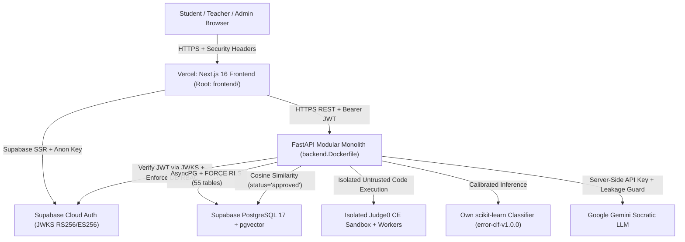
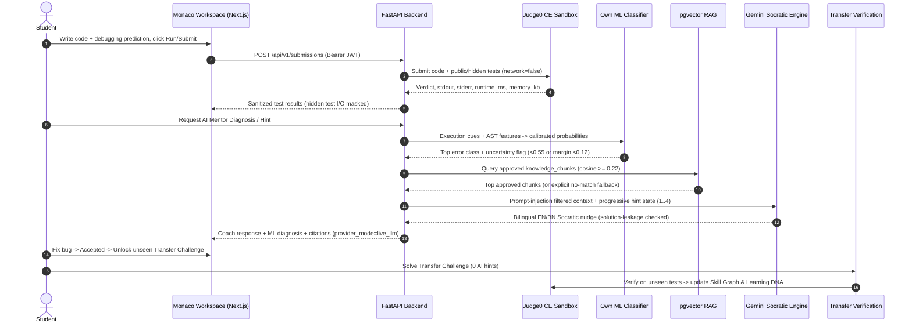
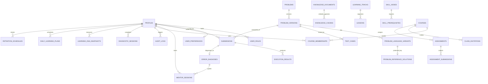

# CodeMentor AI (Think_First) — Final Architecture, Workflow & Database ER Diagrams

## 1. Final Production System Architecture

## 2. Hybrid Execution → ML → RAG → Gemini → Transfer Workflow

## 3. Core Database Entity-Relationship Diagram (PostgreSQL + `pgvector`)

